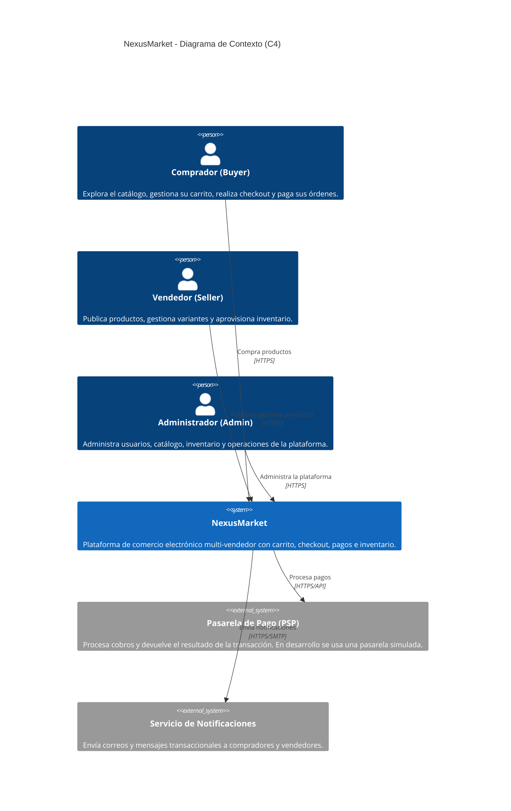

# 01 - Contexto del Sistema

## Propósito

Este documento describe el contexto de negocio de **NexusMarket**, una plataforma de comercio electrónico multi-vendedor. El diagrama C4 de contexto muestra los actores que interactúan con el sistema y los sistemas externos con los que se integra.

## Actores

| Actor | Descripción |
| --- | --- |
| **Buyer / Comprador** | Explora el catálogo, gestiona su carrito, realiza el checkout y paga sus órdenes. |
| **Seller / Vendedor** | Publica productos, gestiona variantes y aprovisiona inventario. |
| **Admin / Administrador** | Administra usuarios, catálogo, inventario y operaciones de la plataforma. |

## Sistemas externos

| Sistema | Descripción |
| --- | --- |
| **Pasarela de Pago (PSP)** | Procesa los cobros y devuelve el resultado de la transacción. En desarrollo se utiliza `SimulatedPaymentGatewayAdapter`. |
| **Servicio de Notificaciones** | Envía correos y mensajes transaccionales a compradores y vendedores. Es una integración prevista; el código actual no incluye aún un adaptador de notificaciones. |

## Diagrama C4 de Contexto

## Alcance

NexusMarket es el sistema central: recibe las peticiones de los usuarios, aplica las reglas de negocio, persiste la información transaccional y coordina las integraciones externas. La pasarela de pago y el servicio de notificaciones quedan fuera del límite del sistema.
