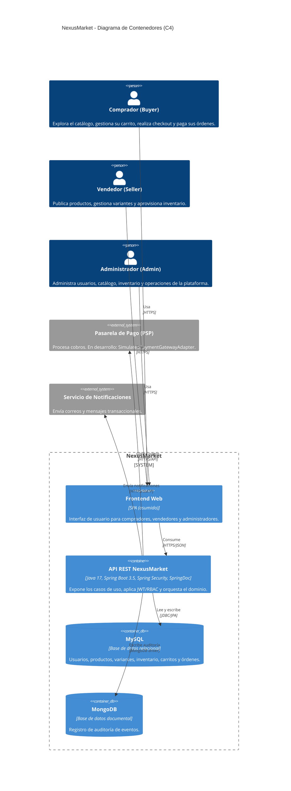

# 02 - Diagrama de Contenedores

## Propósito

Este documento muestra los contenedores desplegables de NexusMarket y las tecnologías principales. El frontend se representa como un contenedor asumido, ya que el repositorio actual contiene únicamente la API REST.

## Contenedores

| Contenedor | Tecnología | Responsabilidad |
| --- | --- | --- |
| **Frontend Web** | SPA (asumido) | Interfaz para compradores, vendedores y administradores. |
| **API REST NexusMarket** | Java 17, Spring Boot 3.5, Spring Security, SpringDoc | Expone los casos de uso, aplica JWT/RBAC y orquesta el dominio. |
| **MySQL** | Base de datos relacional | Persistencia de usuarios, productos, variantes, inventario, carritos y órdenes. |
| **MongoDB** | Base de datos documental | Persistencia de registros de auditoría. |
| **PSP** | Sistema externo | Procesa cobros. En desarrollo se usa una pasarela simulada. |
| **Servicio de Notificaciones** | Sistema externo | Envía notificaciones transaccionales. |

## Diagrama C4 de Contenedores

## Notas de despliegue

- La API REST es stateless: la autenticación se basa en JWT y no se crean sesiones HTTP.
- MySQL concentra el estado transaccional y de catálogo.
- MongoDB se utiliza para auditoría; el adaptador `AuditLogAdapter` escribe documentos en la colección de auditoría.
- La pasarela de pago es sustituible mediante el puerto `PaymentGatewayPort`.
- El servicio de notificaciones es una integración externa prevista; no forma parte del código actual.
