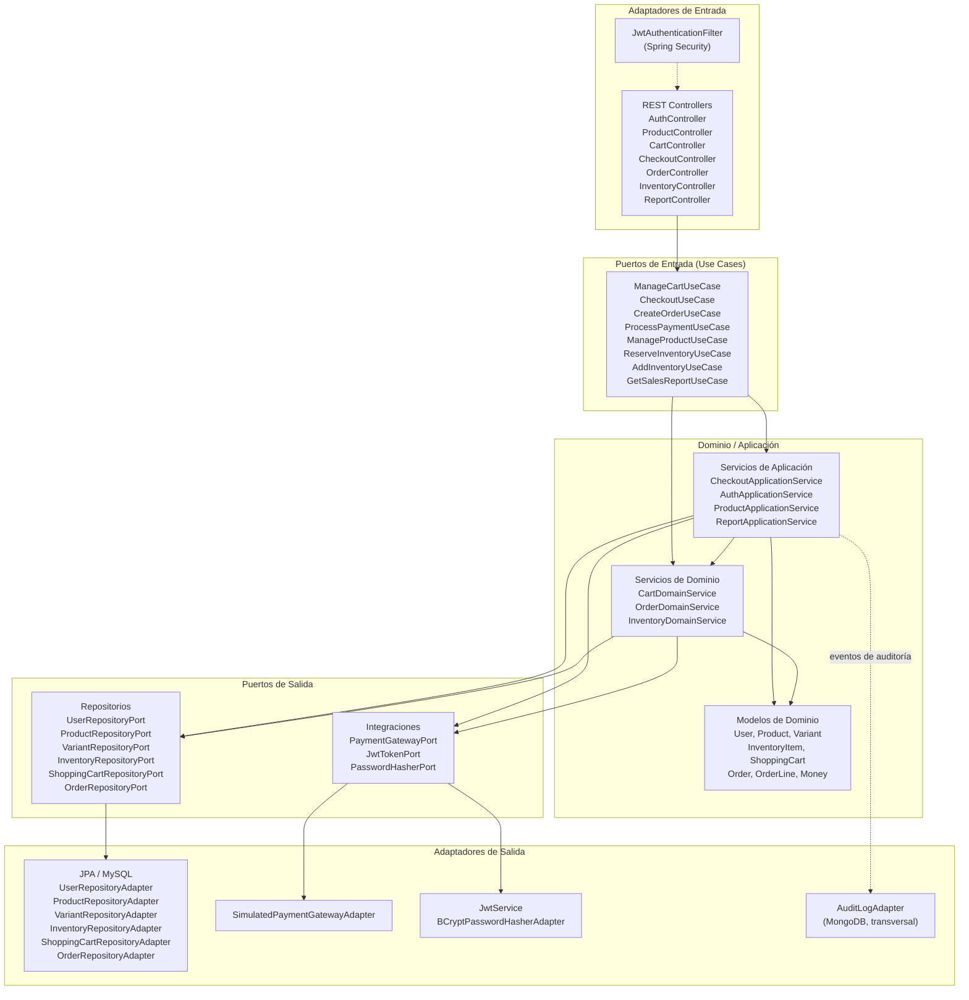

# 03 - Diagrama de Componentes

## Propósito

Este documento muestra la organización interna de NexusMarket siguiendo **Arquitectura Hexagonal** (Ports & Adapters). El flujo principal es:

```text
Adaptadores de entrada -> Puertos de entrada -> Servicios de dominio/aplicación
-> Puertos de salida -> Adaptadores de salida
```

## Diagrama de Componentes



## Responsabilidades por capa

| Capa | Componentes | Responsabilidad |
| --- | --- | --- |
| **Entrada** | Controllers, filtro JWT | Recibir HTTP, validar DTOs, resolver el usuario autenticado y delegar en puertos de entrada. |
| **Puertos de entrada** | Interfaces de casos de uso | Definir el contrato que consume la capa REST sin acoplarla al dominio concreto. |
| **Dominio / Aplicación** | Servicios y modelos | Aplicar reglas de negocio, orquestar casos de uso y mantener el dominio libre de Spring/JPA. |
| **Puertos de salida** | Repositorios e integraciones | Abstraer persistencia, pagos, JWT y hashing de contraseñas. |
| **Salida** | Adaptadores JPA, pago, seguridad, auditoría | Implementar los puertos con tecnologías concretas. |

## Reglas de dependencia

- `domain` no importa Spring, JPA, MongoDB ni anotaciones de persistencia.
- Los controladores nunca exponen modelos de dominio; usan DTOs de request/response.
- Los servicios de dominio/aplicación reciben dependencias por constructor.
- `CheckoutApplicationService` depende de puertos de entrada (`CreateOrderUseCase`, `ReserveInventoryUseCase`) y de puertos de salida para la compensación.
- El adaptador de auditoría MongoDB es transversal; actualmente no existe un `AuditPort` dedicado en el dominio.
