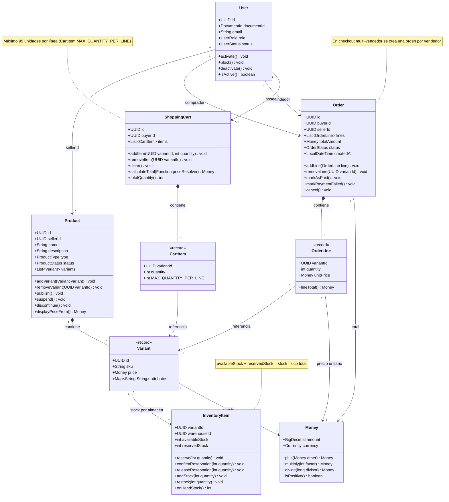

# 04 - Modelo de Dominio

## Propósito

Este documento presenta las entidades y objetos de valor principales del dominio de NexusMarket, junto con sus relaciones. El modelo es deliberadamente rico: las reglas de negocio viven en los propios modelos y servicios de dominio, no en los adaptadores.

## Diagrama de Clases

## Invariantes principales

| Entidad | Invariante |
| --- | --- |
| **User** | Cada cuenta tiene exactamente un rol; el email se normaliza y debe ser único. |
| **Product** | Un producto pertenece a un vendedor y agrupa variantes con SKU único. |
| **Variant** | El precio autoritativo vive en la variante y debe ser positivo. |
| **InventoryItem** | `availableStock` y `reservedStock` no pueden ser negativos; el stock físico es la suma de ambos. |
| **Order** | El total debe coincidir con la suma de las líneas; las líneas solo se modifican antes del pago. |
| **OrderLine** | El precio unitario queda congelado al crear la línea. |
| **ShoppingCart** | Un comprador tiene como máximo un carrito activo y cada línea admite hasta 99 unidades. |
| **Money** | Operaciones monetarias con la misma moneda y sin valores negativos en precios. |

## Relaciones clave

- Un **Buyer** puede tener un carrito y múltiples órdenes.
- Un **Seller** puede tener múltiples productos y recibir órdenes.
- Cada **Order** pertenece a un único vendedor; el checkout multi-vendedor genera una orden por vendedor.
- Cada **OrderLine** referencia una **Variant** y conserva el precio del momento de la compra.
- Cada **InventoryItem** representa el stock de una **Variant** en un almacén concreto.
