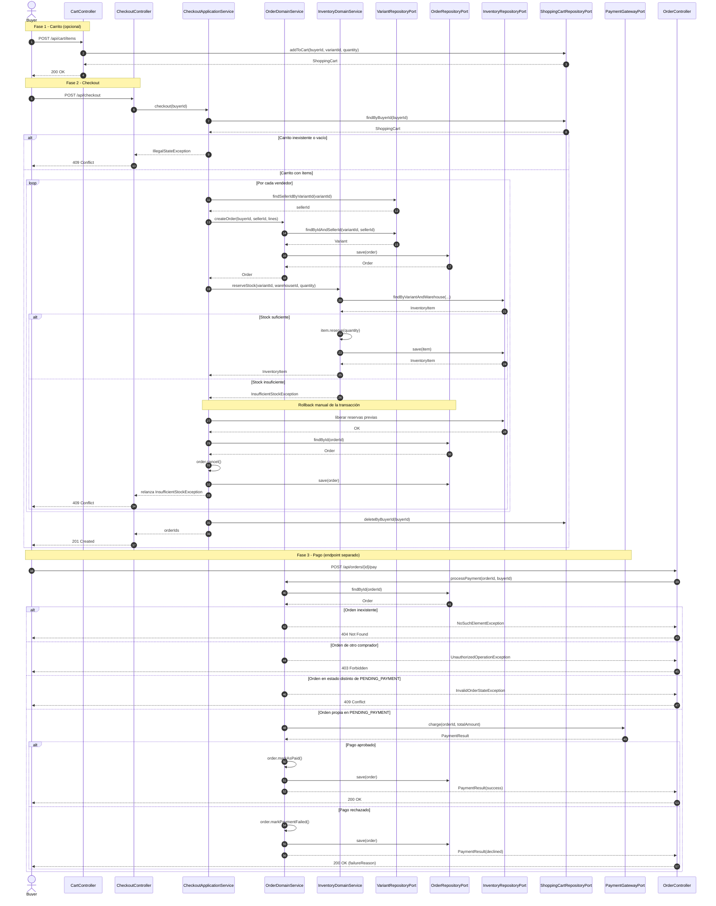

# 05 - Flujo de Checkout y Pago

## Propósito

Este documento describe el flujo de compra de NexusMarket. El checkout crea una orden por vendedor y reserva el inventario de cada línea. Si una reserva falla, se ejecuta una compensación manual: se liberan las reservas ya realizadas y se cancelan las órdenes ya creadas.

> **Nota de implementación:** en el código actual el checkout y el pago son endpoints separados. `POST /api/checkout` crea las órdenes y reserva stock; `POST /api/orders/{id}/pay` procesa el cobro posteriormente. El diagrama muestra ambas fases para cubrir el flujo completo.

## Diagrama de Secuencia

## Puntos importantes

1. **Una orden por vendedor:** el carrito se agrupa por `sellerId`; cada grupo genera una orden independiente.
2. **Precio resuelto en el servidor:** el cliente nunca envía precios; `OrderDomainService` obtiene el precio autoritativo desde `VariantRepositoryPort`.
3. **Reserva y compensación:** cada reserva exitosa se registra en memoria. Si falla una reserva posterior, se liberan las anteriores y se cancelan las órdenes creadas.
4. **Carrito vacío:** el checkout lanza `IllegalStateException`, que se traduce a `409 Conflict`.
5. **Pago separado:** `POST /api/orders/{id}/pay` valida que la orden pertenezca al comprador autenticado antes de llamar a la pasarela.
6. **Pago rechazado:** la orden pasa a `PAYMENT_FAILED` y se persiste; la respuesta HTTP sigue siendo `200 OK` con `successful=false` y `failureReason`.
